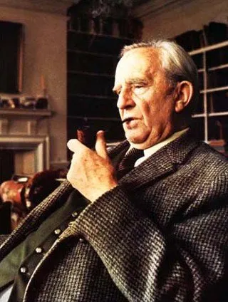

L'autore preferito della nostra presidentissima, Giorgia Meloni, viene rubato. Tolkien viene esposto ed anche messo in mostra. 

Gli viene, infatti, organizzata una mostra alla Galleria Nazionale di Roma che dal 16 novembre sarà visitabile fino all'11 febbraio 2024. E così, forse non di furto ma certamente appropriazione indebita: questa, probabilmente, la qualificazione giuridica più corretta. 

La colpa di Tolkien? Essere l'autore preferito da Giorgia e narratore di mondi immaginari dove prendono forma razze umane immaginarie che combattono guerre immaginarie. Una presunta fierezza nordica col retrogusto religioso. Tutto qui. Non c'è altro.

Questa destra, ovviamente ignorante e priva di autori, è a caccia costantemente di una identità culturale. Cerca qualcuno che le permetta di superare l'abisso, l'enorme divario che la divide dalla sinistra. Questo fortissimo complesso di inferiorità è talmente grande che brucia costantemente e suona come una ingiusta punizione, d'altra parte come poter accettare, questa maledetta sinistra, sempre ricca di produzioni e autori riconosciuti a livello planetario, forieri di cultura. Questi maledetti fortunati non hanno che l'imbarazzo della scelta. Una vera ingiustizia.

E allora? Compito di cerchia ristretta di fidati lacchè, trovare un nuovo mentore, un saggio ispiratore di identità che saldi per sempre e motivi un esercito di moderni marciatori su Roma che, nel frattempo, delusi stanno perdendosi per strada. 

Ed allora via al sortilegio: collegare la mitologia ispirata al libro principale di Tolkien “Il Signore degli anelli” ai campi Hobbit promossi dalla destra neofascista. Una forzatura non da poco ma cosa importa! Intanto ci facciamo una bella mostra alla quale invitare tutti, ma proprio tutto l'establishment, ovviamente Giorgia in testa. 

L'appropriazione indebita è certificata da quanto affermato dallo stesso Tolkien in un messaggio privato dei primi anni Quaranta del Novecento: "Quel dannato piccolo ignorante di Adolf Hitler… ha rovinato, pervertito, abusato e reso sempre maledetto quel nobile spirito nordico, supremo contributo all’Europa, che io ho sempre amato e provato a presentare nella sua vera luce".

## Domande frequenti

<h3>Cos'è la mostra su Tolkien alla Galleria Nazionale di Roma?</h3>

È la mostra dedicata a J.R.R. Tolkien aperta alla Galleria Nazionale di Roma dal 16 novembre 2023 all'11 febbraio 2024, con Giorgia Meloni, che lo indica come il suo autore preferito, in testa agli invitati. Per molti è stata un'operazione politica: collegare il mito del Signore degli Anelli all'identità culturale di una destra che cerca autori di riferimento.

<h3>Cosa pensava Tolkien di Hitler?</h3>

Lo disprezzava. In un messaggio privato dei primi anni Quaranta, Tolkien scrisse che «quel dannato piccolo ignorante di Adolf Hitler» aveva rovinato e pervertito «quel nobile spirito nordico» che lui aveva sempre amato. Per questo legare la sua opera ai campi Hobbit della [destra neofascista](/un-antifascista-al-tempo-della-meloni/) suona come un'appropriazione indebita.

