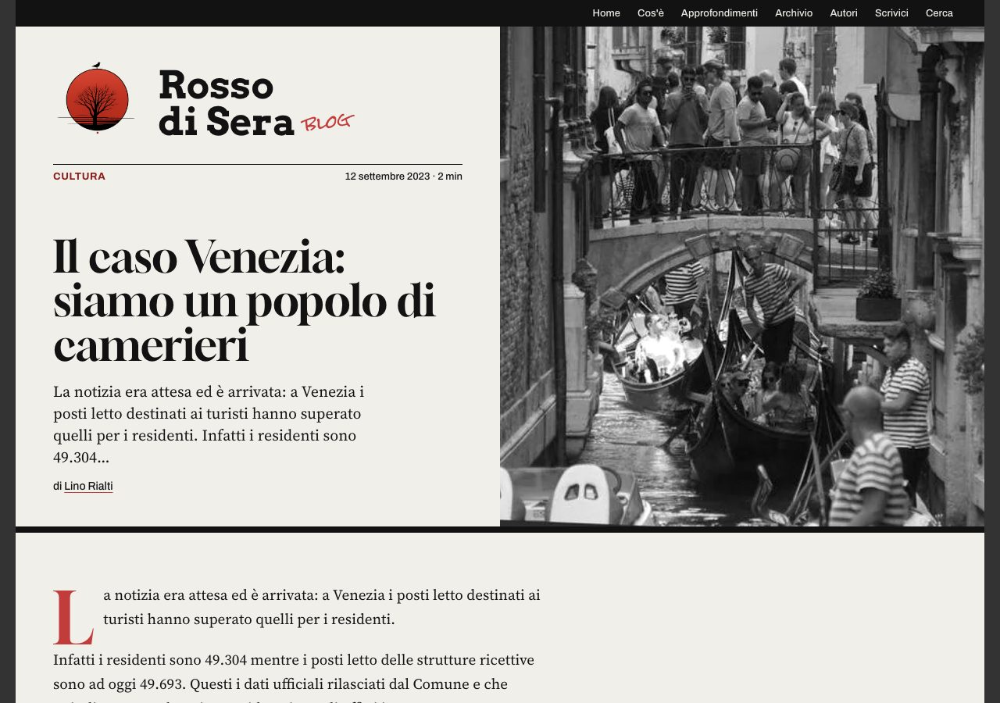
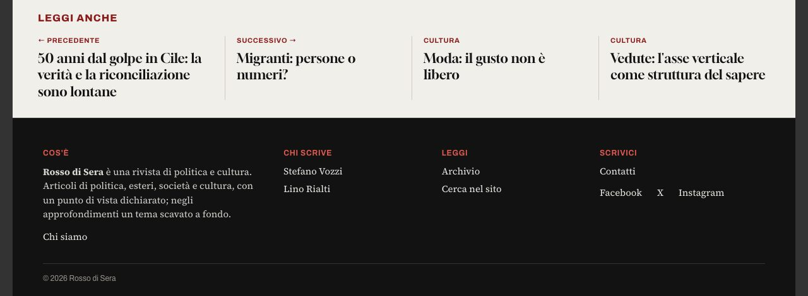
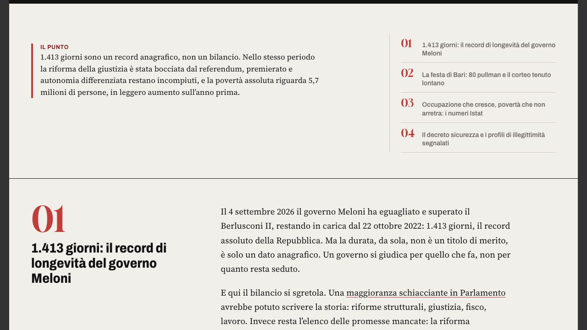
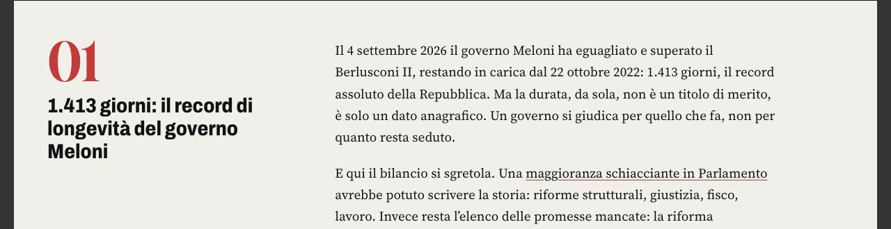
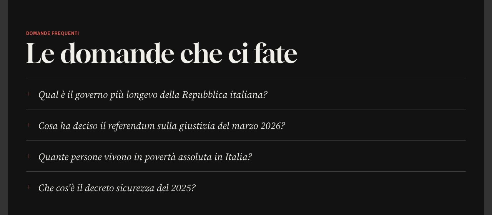
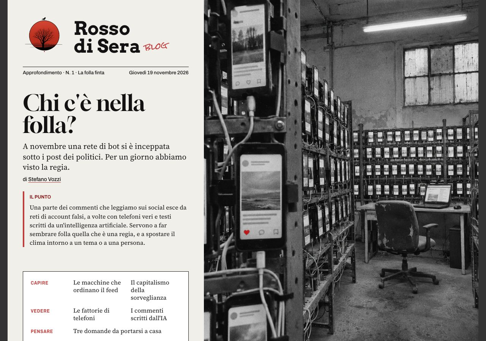
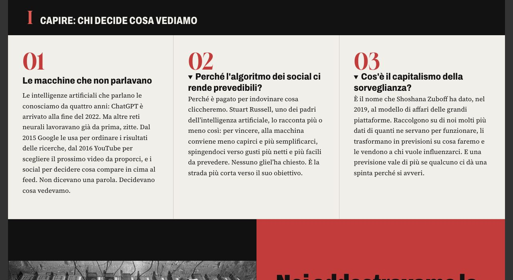
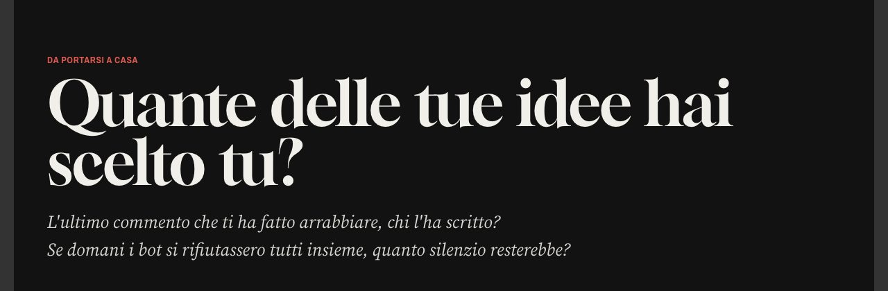
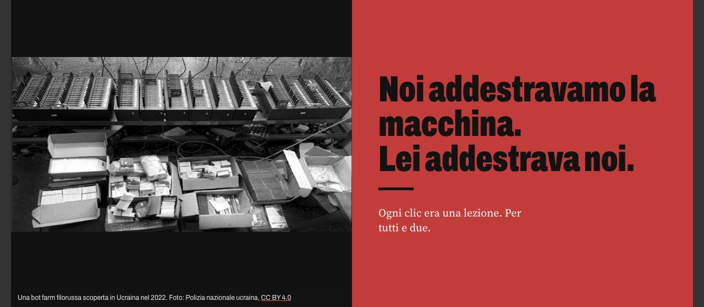
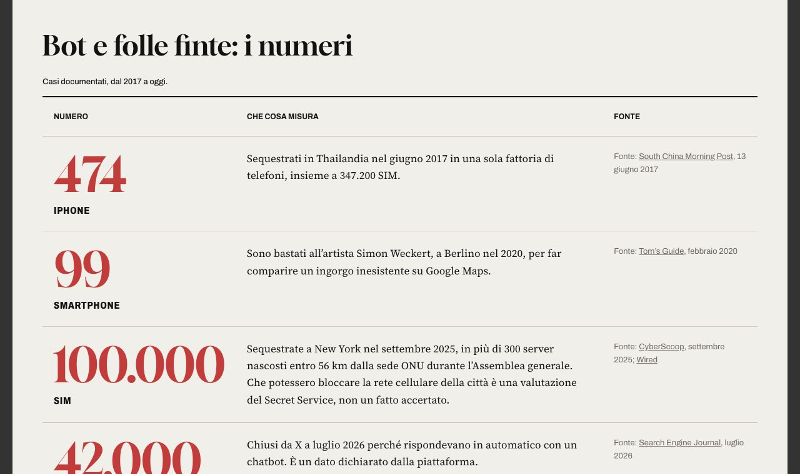



## Perché cambiamo

Lino, il blog funzionava, ma somigliava a tutti gli altri: un articolo dopo l'altro, chi arrivava leggeva quello e se ne andava. Un po' come entrare in un bar, prendere il caffè e uscire senza nemmeno guardarsi intorno.

Sui social, poi, la gara è a chi urla di più. Quella gara non la vinceremo mai, e per fortuna.

Allora cambiamo campo: Rosso di Sera diventa una rivista. Stessa testata, stessi temi, stesso punto di vista dichiarato. Cambia la forma, che adesso si riconosce a colpo d'occhio e invoglia a restare.

La regola di fondo è semplice: la politica è il contenuto, la sorpresa è il modo di raccontarla.

## Articoli e approfondimenti

Sul sito adesso convivono due cose diverse, e conviene non confonderle.

| | Articolo | Approfondimento |
| --- | --- | --- |
| A cosa serve | La notizia, la reazione a caldo, la tua opinione | Un tema preso e scavato fino in fondo |
| Com'è fatto | Un testo di seguito, come hai sempre scritto | Blocchi brevi, numerati, divisi in tre parti |
| Quando esce | Quando c'è qualcosa da dire | Uno alla volta, quando è pronto |
| Come si prepara | Come sempre | Parti da un tuo articolo e lo riorganizzi con l'IA |

Il primo approfondimento uscito è [Chi c'è nella folla?](/approfondimenti/chi-ce-nella-folla/): aprilo sul telefono e scorrilo, si capisce prima così che leggendo queste righe.

## Gli articoli nella veste nuova

Gli articoli si scrivono come prima, nel modulo di sempre. Cambia la pagina, e con lei il peso di alcune caselle.

{: loading="lazy" style="width:100%;height:auto;border:1px solid #121212;margin:8px 0 24px"}

- **In alto** ci sono la categoria, che porta a tutti gli articoli dello stesso tema, la data e i minuti di lettura.
- **Sotto il titolo** adesso si legge la descrizione (la casella «Meta description»). Prima la vedeva solo Google, ora la legge chiunque apra la pagina: scrivila come una frase per il lettore, che dice di cosa parla il pezzo senza ripetere l'inizio. Nell'esempio qui sopra la descrizione e la prima riga dell'articolo sono uguali, e il lettore legge la stessa frase due volte.
- **La foto** sta a destra del titolo, grande. La didascalia, se c'è, compare sotto.
- **In fondo** il sito mette da solo «Leggi anche»: l'articolo precedente, il successivo e altri due dello stesso tema. Per questo la categoria giusta conta più di prima.

{: loading="lazy" style="width:100%;height:auto;border:1px solid #121212;margin:8px 0 24px"}

### I capitoli

La novità più grossa sta dentro il testo: la pagina si costruisce da sola a partire dai titoletti. Nel modulo dell'articolo sono i titoli di livello 2 (il pulsante H2, o `##` all'inizio della riga).

- **Il testo prima del primo titoletto** è l'attacco: la prima lettera diventa il capolettera, e accanto compare da solo l'indice dei capitoli.
- **Ogni titoletto** diventa un capitolo numerato (01, 02, 03...), con il numero e il titolo nella colonna di sinistra e il testo a destra. Il titolo deve capirsi da solo, perché finisce anche nell'indice.
- **Una citazione che comincia con «Il punto»** (in grassetto) resta un riquadro con il filetto rosso: è la tesi detta in chiaro, come negli approfondimenti.
- **Le altre citazioni** diventano una pagina rossa a tutta larghezza, come la frase rossa: meglio usarle per una frase sola, forte.
- **Un titoletto «Domande frequenti»** alla fine diventa la fascia nera delle domande. Quella non devi scriverla tu: le domande le aggiungiamo noi quando ottimizziamo l'articolo per Google.

Un articolo senza titoletti funziona lo stesso, ma resta un blocco unico di testo: due o tre capitoli lo rendono molto più leggibile, soprattutto sul telefono.

L'attacco con «Il punto» e l'indice dei capitoli, nel tuo articolo sul governo più longevo:

{: loading="lazy" style="width:100%;height:auto;border:1px solid #121212;margin:8px 0 24px"}

Un capitolo:

{: loading="lazy" style="width:100%;height:auto;border:1px solid #121212;margin:8px 0 24px"}

La fascia delle domande frequenti:

{: loading="lazy" style="width:100%;height:auto;border:1px solid #121212;margin:8px 0 24px"}

## Com'è fatto un approfondimento

Ogni approfondimento ha sempre gli stessi pezzi, nello stesso ordine. Il lettore impara la strada una volta e poi ci cammina da solo.

1. **La copertina**: il titolo, meglio se è una domanda, due righe sotto (il catenaccio), il riquadro «Il punto» con la tesi detta in chiaro, la foto.
2. **Il tema**: un'apertura di 150-200 parole che porta dentro l'argomento, come l'inizio di un racconto.
3. **Capire**: chi, che cosa, perché non è quello che sembra. Si spiega da zero, perché chi arriva da Facebook non sa niente.
4. **Vedere**: come funziona, un caso da vicino, almeno un dato vero in tabella, e l'obiezione («allora è tutto...?»). Il dubbio è quello che ci separa dai social.
5. **Pensare**: chiamare le cose con il loro nome, le strade possibili.
6. **Le domande**: tre, la prima grande, al posto delle conclusioni.

Ecco come appaiono in «Chi c'è nella folla?».

**La copertina**: titolo, catenaccio, «Il punto», il sommario delle tre parti, la foto.

{: loading="lazy" style="width:100%;height:auto;border:1px solid #121212;margin:8px 0 24px"}

**Una fascia**: il nome della parte (qui Capire) e i suoi blocchi numerati. Il 02 e il 03 hanno per titolo una domanda.

{: loading="lazy" style="width:100%;height:auto;border:1px solid #121212;margin:8px 0 24px"}

**Le domande finali**, al posto delle conclusioni.

{: loading="lazy" style="width:100%;height:auto;border:1px solid #121212;margin:8px 0 24px"}

In mezzo ci sono due pezzi speciali. La **frase rossa** è una pagina tutta rossa con la frase più forte del pezzo, accanto alla seconda foto. La **tabella** mette in fila i numeri con le loro fonti.

{: loading="lazy" style="width:100%;height:auto;border:1px solid #121212;margin:8px 0 24px"}

{: loading="lazy" style="width:100%;height:auto;border:1px solid #121212;margin:8px 0 24px"}

I blocchi sono corti, da 40 a 90 parole, e il loro titolo deve capirsi da solo. Quelli che hanno per titolo una domanda finiscono anche su Google come risposte.

## Cosa deve succedere a chi legge

Nei primi tre secondi chi apre la pagina deve pensare: «questo è diverso dal solito, voglio capire». Alla fine deve uscire con una prospettiva nuova e una domanda in tasca, non con una risposta già masticata.

E deve venirgli voglia di girarlo a qualcuno. È così che cresciamo, non con la pubblicità.

Quello che teniamo fuori:

- il piagnisteo e l'indignazione da bacheca;
- la superficialità, il titolo urlato che poi non mantiene;
- le risposte che nessuno ha chiesto, la predica.

Il peso c'è, i temi sono seri. Ma se il lettore si sente trattato da adulto, resta. Se si sente fatto la morale, chiude la pagina e torna su Facebook a litigare.

## Dall'articolo all'approfondimento, in quattro passi

Non devi impaginare niente a mano: scrivi il tuo articolo come sempre, l'IA lo riorganizza, il sito lo impagina. Va bene ChatGPT, ma anche Claude, Gemini o Grok, pure nelle versioni gratuite.

1. **Apri un approfondimento nuovo.** Nel pannello del blog (rossodiserablog.it/admin) vai in «Approfondimenti» e premi «Nuovo». La prima casella, «Testo preparato con l'IA», contiene già le istruzioni per l'IA (il prompt).
2. **Incolla il tuo articolo sotto il prompt.** In fondo alla casella c'è la riga «ECCO IL MIO ARTICOLO»: cancella la riga sotto e incolla l'articolo.
3. **Passa tutto all'IA.** Clicca nella casella, premi Cmd+A e poi Cmd+C, apri ChatGPT e incolla. Aspetta che abbia finito di scrivere.
4. **Rimetti la risposta nella casella.** Copia la risposta, torna nel pannello, cancella tutto quello che c'è nella casella e incolla la risposta al posto del prompt.

A destra vedi subito la pagina come verrà. Se nella casella è rimasto il prompt invece della risposta, l'anteprima te lo dice in alto, e il sito non pubblica niente.

## Le caselle da compilare

Il testo dell'IA riempie quasi tutta la pagina. A mano restano poche caselle, e le foto.

| Casella | Cosa ci metti |
| --- | --- |
| Numero | Il numero dell'approfondimento: il prossimo dopo l'ultimo uscito |
| Titolo | Lo copi dalla prima riga della risposta dell'IA |
| Autore | Tu |
| Categoria | L'argomento: politica, esteri, società, economia... |
| Foto di copertina | La foto grande in alto, più una riga che dice cosa si vede |
| Seconda foto | Quella accanto alla frase rossa, più la sua riga di descrizione |

Per ognuna delle due foto dici se è generata (sotto comparirà «Illustrazione generata») o vera, e allora servono i crediti nella didascalia.

Lo stile delle foto è sempre lo stesso: bianco e nero da reportage, un solo dettaglio rosso, nessuna persona reale inventata. L'IA nella sua risposta ti propone già un'idea per la copertina.

Tema breve, titolo per Google, descrizione e parola chiave non li tocchi: li prende il sito dalle prime righe della risposta. Tutte le altre caselle che vedi più sotto puoi lasciarle vuote.

## Anteprima e uscita

Finché non lo decidi tu, l'approfondimento non esce. Salva quante volte vuoi.

1. **Mentre scrivi**, a destra nel pannello vedi la pagina quasi uguale a quella vera.
2. **Dopo il salvataggio**, in pochi minuti trovi la pagina vera all'indirizzo rossodiserablog.it/anteprima/ seguito dal nome. La vede solo chi ha il link, Google no: guardala sul telefono, mandala a me.
3. **Quando è pronto**, accendi «Esce sul sito» e metti giorno e ora. Esce da solo a quell'ora, entro un'ora al massimo. Se la data è nel futuro, aspetta quel momento.

Dopo l'uscita lo trovi in «Approfondimenti usciti»: da lì si correggono gli errori, nella stessa casella del testo.

## I dati

I numeri sono la cosa che ci distingue dalle chiacchiere da bar, quindi devono essere giusti. Le verifiche le fai tu, prima di accendere «Esce sul sito».

Il prompt dice all'IA di usare solo i dati del tuo articolo e di non inventarne. Nelle prove con ChatGPT e Gemini su due tuoi articoli ha rispettato la regola. Ma un'IA ogni tanto giura di aver controllato quando non l'ha fatto, quindi l'ultima occhiata alla tabella tocca a noi.

Per ogni numero in tabella:

- è nel tuo articolo, o l'hai controllato sulla fonte originale;
- la fonte è scritta sotto, meglio se con il link;
- se il dato ha un limite che lo indebolisce, è scritto nella riga «Limiti dei dati».

